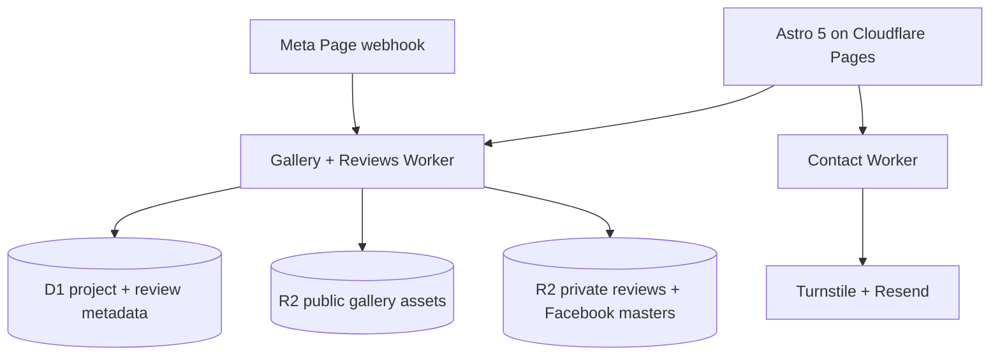

<div align="center">

# 🏠 KIL Construction

### Serverless construction website · Galleries · Reviews · Custom administration

[](https://kilcon.work)
[](https://astro.build/)
[](https://www.cloudflare.com/)

[](LICENSE)

**[🌐 Live Site](https://kilcon.work)** · **[📸 Project Gallery](https://kilcon.work/projects)** · **[GitHub](https://github.com/joshua-werlein/kilConstruction)** · **[👨‍💻 Developer Portfolio](https://joshuawerlein.com)**

</div>

---

## ✨ Overview

A production website and custom content platform built for a construction business. Its owner can organize project imagery, manage customer reviews, and maintain public content without editing code or relying on a third-party CMS.

The Astro 5 website runs on Cloudflare Pages, with two separately deployed Workers in this repository. The gallery Worker handles media, reviews, Facebook webhooks, and import controls; the contact Worker verifies Turnstile challenges and delivers messages through Resend. D1 holds project/photo metadata while R2 holds image files.

## 🚀 Features

| Area | What it does |
| :--- | :--- |
| 🖼️ **Project galleries** | Categorized Projects and Services pages, manual R2 uploads, Facebook-managed galleries, and image management |
| 🔐 **Admin dashboard** | Authenticated content administration with signed sessions and protected mutations |
| ⭐ **Customer reviews** | Review submission, moderation, featured reviews, and private review-photo storage |
| ☁️ **Cloud media** | R2 image files, private Facebook masters, protected review attachments, and visibility-gated image delivery |
| 📩 **Contact workflow** | Cloudflare Turnstile checks and Resend delivery through a separate Worker |
| 📘 **Facebook integration** | Signed Meta Page webhooks, automatic new-post imports, per-photo duplicate comparison and review, and guarded historical imports |
| 🛡️ **Security controls** | Input checks, scoped media access, rate limits, and regression tests for path/URL variations |

## 🧩 Architecture



| Source | Responsibility |
| :--- | :--- |
| [Astro application](src/) | Public pages, admin sign-in, and same-origin API routes |
| [Gallery and reviews Worker](workers/kilcon-gallery-worker/) | D1 records, R2 media, moderation, and Facebook imports |
| [Contact Worker](workers/kilcon-contact/) | Turnstile verification and Resend delivery |

> **Deployment boundary:** The Astro site and two Workers deploy separately. A site push does not automatically redeploy the backend Workers.

## 🔎 Media and Facebook integration

The gallery Worker validates signed admin sessions for privileged operations. Project images and private review uploads use separate R2 storage. The review photo endpoint requires approval for public viewing and authorizes admins to inspect pending submissions.

Production receives signature-verified Meta Page webhooks and deduplicates eligible new-post imports. Photos are stored in R2; D1 stores Facebook project records, album mappings, per-photo review decisions, captions, import state, and visibility. The **Manage Images** page lists both manual R2 folders and Facebook-managed D1 projects. Facebook projects remain independently manageable through **Facebook Gallery Sync**.\n\nThe admin **Facebook Photo Review** page compares Facebook photos against existing website galleries (including visual duplicate hints) and saves **Import**, **Duplicate / Skip**, or **Review later** decisions. Saving **Import** is an approval, not an upload. Historical imports require a separately authorized, bounded operation; unrestricted historical import and automatic album discovery remain disabled in the documented production configuration. Existing signed webhook imports of new Page posts continue automatically.\n\n**In progress, not yet deployed:** self-service **Import Approved Photos** within the review page and optional caption-hashtag categorization. These must not be described as live until their separate rollout is verified.

<details>
<summary><strong>Implementation and rollout details</strong></summary>

- [Gallery and review access checks](workers/kilcon-gallery-worker/src/index.js)
- [Webhook verification and imports](docs/facebook-webhook.md)
- [Album discovery, preview, and release gates](docs/facebook-album-implementation.md)
- [Historical photo review and duplicate decisions](docs/facebook-photo-review.md)
- [Current handoff and feature flags](docs/RESUME.md)
- [Verified production flags](docs/security-release-2026-11-19.md)

</details>

## 📷 Screenshots

| Homepage | Project gallery |
| :---: | :---: |
| [](docs/screenshots/homepage.png) | [](docs/screenshots/projectsGallery.png) |

| Admin dashboard | Admin media management |
| :---: | :---: |
| [](docs/screenshots/adminDashboard.png) | [](docs/screenshots/manageImages.png) |

<details>
<summary><strong>More screenshots</strong></summary>

| Review moderation | Contact page |
| :---: | :---: |
| [](docs/screenshots/manageReviews.png) | [](docs/screenshots/contactPage.png) |

</details>

## 💻 Development

The Pages-hosted site currently uses **Astro 5**, with separate Workers for the gallery/reviews and contact APIs. See [package.json](package.json) for dependencies and commands. An Astro 7 migration has not been deployed.

```bash
npm ci
npm run dev
npm run build
npm run test:site
npm run test:gallery-worker
```

Cloudflare account access, Worker bindings, D1 migrations, R2 buckets, and secrets are required for a fully functional deployment. **Never run production migrations or historical imports as part of README maintenance.**

## 📜 License and authorship

The code and client materials are **proprietary**. The repository is available for technical review, not as a grant of permission to copy or reuse it. See [LICENSE](LICENSE).

**Developed and maintained by Joshua Werlein** · [Portfolio](https://joshuawerlein.com) · [GitHub](https://github.com/joshua-werlein)
