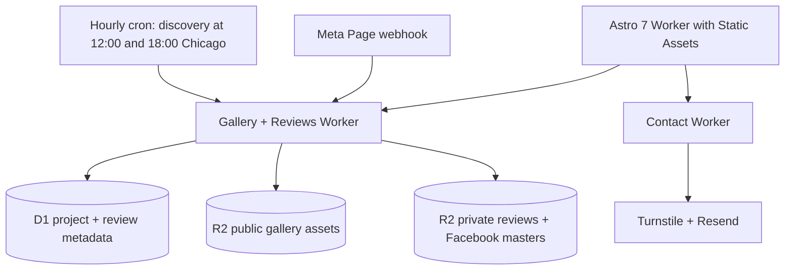

<div align="center">

# 🏠 KIL Construction

### Serverless construction website · Galleries · Reviews · Custom administration

[](https://kilcon.work)
[](https://astro.build/)
[](https://www.cloudflare.com/)

[](LICENSE)

**[🌐 Live Site](https://kilcon.work)** · **[📸 Project Gallery](https://kilcon.work/projects)** · **[GitHub](https://github.com/joshua-werlein/kilConstruction)** · **[👨‍💻 Developer Portfolio](https://joshuawerlein.com)**

</div>

---

## ✨ Overview

A production website and custom content platform built for a construction business. Its owner can organize project imagery, manage customer reviews, and maintain public content without editing code or relying on a third-party CMS.

The Astro 7 website runs as a Cloudflare Worker with Static Assets (`kilcon-site`, see [wrangler.jsonc](wrangler.jsonc)). Pages and API routes are server-rendered by the Worker; built files in `dist/` are served as static assets. Two more Workers are deployed separately from this repository. The gallery Worker handles media, reviews, Facebook webhooks, and import controls; the contact Worker verifies Turnstile challenges and delivers messages through Resend. D1 holds project/photo metadata while R2 holds image files.

## 🚀 Features

| Area | What it does |
| :--- | :--- |
| 🖼️ **Project galleries** | Categorized Projects and Services pages, manual R2 uploads, Facebook-managed galleries, and image management |
| 🔐 **Admin dashboard** | Authenticated content administration with signed sessions and protected mutations |
| ⭐ **Customer reviews** | Review submission, moderation, featured reviews, and private review-photo storage |
| ☁️ **Cloud media** | R2 image files, private Facebook masters, protected review attachments, and visibility-gated image delivery |
| 📩 **Contact workflow** | Cloudflare Turnstile checks and Resend delivery through a separate Worker |
| 🧢 **Apparel requests** | Item pages with sizes managed in admin; **Request This Item** sends name, email, size (or another size), quantity and notes straight from the item page through Turnstile and Resend. No online payment ([workflow](docs/apparel-requests.md)) |
| 📘 **Facebook integration** | Signed Meta Page webhooks, automatic new-post imports, per-photo duplicate comparison and review, and guarded historical imports |
| 🛡️ **Security controls** | Enforced Content Security Policy, signed admin sessions, rate limits, input and upload validation, scoped media access, and regression tests |

## 🧩 Architecture



| Source | Responsibility |
| :--- | :--- |
| [Astro application](src/) | Public pages, admin sign-in, and same-origin API routes |
| [Gallery and reviews Worker](workers/kilcon-gallery-worker/) | D1 records, R2 media, moderation, and Facebook imports |
| [Contact Worker](workers/kilcon-contact/) | Turnstile verification and Resend delivery |

> **Deployment boundary:** Workers Builds deploys `kilcon-site` on every push to `main`. The Gallery and Contact Workers are deployed by hand with an explicit `--config`; a site push never redeploys them.

## 🧢 Apparel requests

Online payment is retired; the Stripe endpoints answer `410 Gone`.
1. **The form:** on `/apparel/<item>`, the customer enters **Full Name**, **Email Address**,
   **size** (or *Other size*), **quantity** and optional **notes**, completes Turnstile, and
   presses **Request This Item**.
2. **Sending:** the page sends the request directly to the Contact Worker with the same honeypot,
   rate limit, Turnstile check and Resend delivery as the contact form, with Reply-To set to the
   customer. Personal details travel only in the POST body, never in a URL.
3. **The result:** a confirmation appears on the page only after Resend accepts the message. On
   any failure the customer's entries stay in place for a retry.

Without JavaScript, the button opens the contact page and passes only the item, size and
quantity. Nothing is stored in a database. See [docs/apparel-requests.md](docs/apparel-requests.md).

## 🔎 Media and Facebook integration

The gallery Worker validates signed admin sessions for privileged operations. Project images and private review uploads use separate R2 storage. The review photo endpoint requires approval for public viewing and authorizes admins to inspect pending submissions.

Production receives signature-verified Meta Page webhooks and deduplicates eligible new-post imports. Photos are stored in R2; D1 stores Facebook project records, album mappings, per-photo review decisions, captions, import state, and visibility. The **Manage Images** page lists both manual R2 folders and Facebook-managed D1 projects. Facebook projects remain independently manageable through **Facebook Gallery Sync**.

The admin **Facebook Photo Review** page compares Facebook photos against existing website galleries (including visual duplicate hints) and saves **Import**, **Duplicate / Skip**, or **Review later** decisions. Saving **Import** is an approval, not an upload. **Import Approved Photos** then imports an album's approved photos into the chosen gallery:
- a dry-run check, a confirmation dialog, and confirmed batches of at most 10 photos, with progress and a summary;
- albums that hold several projects can send each batch to a different gallery;
- the destination can be any existing gallery, including the manual website galleries, which are linked automatically and never duplicated;
- a new gallery can be created on the spot, after a check for an existing match and a confirmation.

It is a scoped, authenticated operation (`FB_REVIEWED_IMPORT_ENABLED`) that takes explicit approved photo IDs only and can't start a historical scan. Unrestricted historical import stays disabled (`FB_HISTORICAL_IMPORT_ENABLED`).

**Album discovery** (`FB_DISCOVERY_ENABLED`) reconciles the Page's albums twice daily, at 12:00 and 18:00 America/Chicago. An hourly cron runs, and the Worker acts only in those two slots. It considers only content newer than its cutoff (2026-11-22), so it picks up new photos added to existing albums without re-importing history.

Signed webhook imports of new Page posts continue automatically:
- a new Facebook album with a distinctive name becomes its own gallery;
- an album named exactly like an existing gallery joins it;
- ambiguous cases (similar or vague names, several galleries named, a finished job with no album) are **held for admin review** instead of being guessed. See [grouping rules](docs/facebook-webhook.md).

**Optional caption hashtags** on new Facebook posts:
- `#project`, `#newconstruction`, `#remodels` and `#furniture` choose the category of a gallery the post creates.
- `#highlight` adds the post's photos to the homepage Highlights.

The tags are hidden on the website, never change existing galleries, and are ignored by historical imports. See the [hashtag guide](docs/facebook-hashtags.md).

<details>
<summary><strong>Implementation and rollout details</strong></summary>

- [Gallery and review access checks](workers/kilcon-gallery-worker/src/index.js)
- [Webhook verification and imports](docs/facebook-webhook.md)
- [Album discovery, preview, and release gates](docs/facebook-album-implementation.md)
- [Historical photo review and duplicate decisions](docs/facebook-photo-review.md)
- [Caption hashtags (contractor guide)](docs/facebook-hashtags.md)
- [Current handoff and feature flags](docs/RESUME.md)
- [Security headers and CSP](docs/security-headers.md)

</details>

## 📷 Screenshots

| Homepage | Project gallery |
| :---: | :---: |
| [](docs/screenshots/homepage.png) | [](docs/screenshots/projectsGallery.png) |

| Admin dashboard | Admin media management |
| :---: | :---: |
| [](docs/screenshots/adminDashboard.png) | [](docs/screenshots/manageImages.png) |

<details>
<summary><strong>More screenshots</strong></summary>

| Review moderation | Contact page |
| :---: | :---: |
| [](docs/screenshots/manageReviews.png) | [](docs/screenshots/contactPage.png) |

</details>

## 💻 Development

The site uses **Astro 7** with `@astrojs/cloudflare` 14 and runs on Workers with Static Assets (Node 22.23.4 or newer). Bindings come from `src/utils/runtimeEnv.ts` (`cloudflare:workers`). Separate Workers serve the gallery/reviews and contact APIs. It replaced Cloudflare Pages (Astro 5) on 2026-11-23. Deploys, rollback and Pages retirement are in [docs/production-deploy.md](docs/production-deploy.md); the migration history is in [docs/astro7-migration.md](docs/astro7-migration.md).

```bash
npm ci
npm run dev
npm run build
npm run test:site
npm run test:gallery-worker
npm run check                    # astro check
npm run site:dry-run             # build + build check + package the site Worker, no upload
npm run site:deploy              # same, then upload (clean checkout only; normally Workers Builds deploys main)
npm run gallery-worker:dry-run   # always explicit --config
npm run contact-worker:dry-run
npm run test:contact-worker
```

**Local Gallery and Contact APIs:** production Workers trust only `https://kilcon.work` as a CORS origin. For local admin or review work, run `npm run dev:gallery-worker` (port 8787) and set `PUBLIC_GALLERY_API=http://localhost:8787/api/gallery-api` in `.env`; for the contact form, run `npm run dev:contact-worker`. Both pass `--var ALLOW_DEV_ORIGINS:true`, which lets `http://localhost:4321` and `http://127.0.0.1:4321` call them. Never set that variable in a `wrangler.toml`. `wrangler dev` uses local D1 and R2 storage, never production data.

**Build production only from a clean checkout** (CI or a fresh `git worktree`). A local `.env` is baked into the build, and `site:deploy` refuses such builds (`scripts/check-site-build.mjs`).

**Always pass `--config workers/<worker>/wrangler.toml` to Wrangler for the Gallery and Contact Workers.** After `astro build`, `.wrangler/deploy/config.json` redirects config-less Wrangler commands to the site Worker.

Cloudflare account access, Worker bindings, D1 migrations, R2 buckets, and secrets are required for a fully functional deployment. **Never run production migrations or historical imports as part of README maintenance.**

## 📜 License and authorship

The code and client materials are **proprietary**. The repository is available for technical review, not as a grant of permission to copy or reuse it. See [LICENSE](LICENSE).

**Developed and maintained by Joshua Werlein** · [Portfolio](https://joshuawerlein.com) · [GitHub](https://github.com/joshua-werlein)
