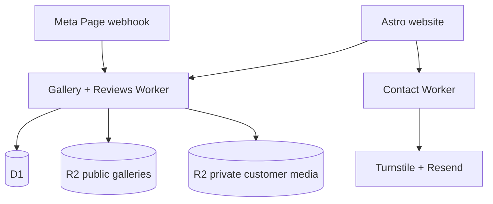

<div align="center">

# 🏠 KIL Construction

### Serverless construction website · Galleries · Reviews · Custom administration

[](https://kilcon.work)
[](https://astro.build/)
[](https://www.cloudflare.com/)

[](LICENSE)

**[🌐 Live Site](https://kilcon.work)** · **[📸 Project Gallery](https://kilcon.work/projects)** · **[👨‍💻 Developer Portfolio](https://joshuawerlein.com)**

</div>

---

## ✨ Overview

A production website and custom content platform built for a construction business. Its owner can organize project imagery, manage customer reviews, and maintain public content without editing code or relying on a third-party CMS.

The interesting engineering work is behind the visuals: **signed admin sessions, Cloudflare Worker APIs, D1 data, R2 media, Facebook integration, and privacy-aware customer uploads**.

## 🚀 Features

| Area | What it does |
| :--- | :--- |
| 🖼️ **Project galleries** | Categorized project and service pages, uploads, image management, and responsive presentation |
| 🔐 **Admin dashboard** | Authenticated content administration with signed sessions and protected mutations |
| ⭐ **Customer reviews** | Review submission, moderation, featured reviews, and private review-photo storage |
| ☁️ **Cloud media** | R2 public gallery storage alongside separately restricted customer media |
| 📩 **Contact workflow** | Cloudflare Turnstile checks and Resend delivery through a separate Worker |
| 📘 **Facebook integration** | Signed Meta webhook handling, deduplication, new-post import tooling, and admin preview/reconciliation workflows |
| 🛡️ **Security controls** | Input checks, scoped media access, rate limits, and regression tests for path/URL variations |

## 🧩 Architecture



This repository contains **all three code areas**, rather than only the frontend:

```text
src/                                 # Astro site, public pages, and administration
workers/kilcon-gallery-worker/       # Gallery, reviews, Facebook, D1 and R2 APIs
workers/kilcon-contact/              # Contact form and email integration
migrations/                          # Versioned D1 migrations
docs/                                # Security notes and integration runbooks
```

> **Deployment boundary:** The Astro site and two Workers deploy separately. A site push does not automatically redeploy the backend Workers.

## 🔎 Selected engineering challenges

**Private customer content:** Review images and data use controlled private storage and access checks. Security work specifically addressed alternate path encodings, image proxy routes, and public-storage exposure.

**Event-driven media imports:** Meta webhook payloads are signature-verified, deduplicated, and reconciled against stored state. Import/discovery workflows include dry-run preview and administrative controls rather than blindly importing every historical photo.

**Safe content changes:** Image deletion, review moderation, and Facebook removal handling distinguish public content from material that must no longer be exposed.

### 📌 Facebook integration status

The production site has new-post import functionality configured, but **historical album reconciliation and broader album-only discovery should not be described as complete**. Their implementation, release gates, and verification requirements are documented separately:

- [Facebook webhook and import operations](docs/facebook-webhook.md)
- [Album discovery and historical preview](docs/facebook-album-implementation.md)
- [Security release and rollout notes](docs/security-release-2026-11-19.md)

## 📷 Screenshots

| Homepage | Project gallery |
| :---: | :---: |
|  |  |

| Admin dashboard | Admin media management |
| :---: | :---: |
|  |  |

<details>
<summary><strong>🖼️ More screenshots</strong></summary>

| Review moderation | Contact page |
| :---: | :---: |
|  |  |

</details>

## 💻 Development

This repository currently declares **Astro 5** in `package.json`; do not change the badge to Astro 7 until that upgrade is merged and verified.

```bash
npm install
npm run dev
npm run build
npm run test:site
npm run test:gallery-worker
```

Cloudflare account access, Worker bindings, D1 migrations, R2 buckets, and secrets are required for a fully functional deployment. **Never run production migrations or historical imports as part of README maintenance.**

## 📜 License and authorship

The code and client materials are **proprietary**. The repository is available for technical review, not as a grant of permission to copy or reuse it. See [LICENSE](LICENSE).

**Developed and maintained by Joshua Werlein** · [Portfolio](https://joshuawerlein.com) · [GitHub](https://github.com/joshua-werlein)
